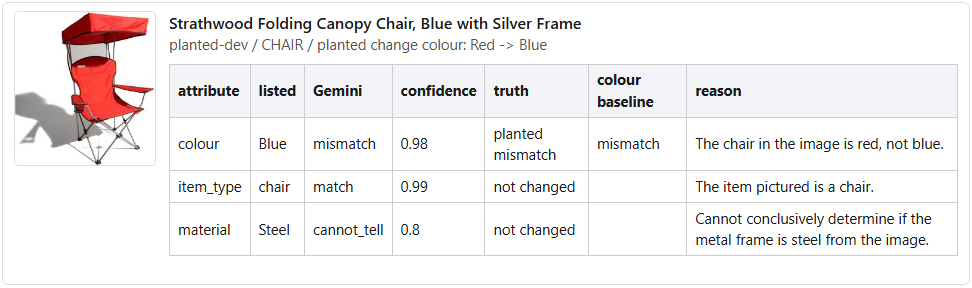

# Listing mismatch detector

**Catches product listings whose photo contradicts the text.**

`Vision model with abstention` · `Pre-registered evaluation` · `Your key stays in your browser`

**[Try the demo](https://anirudhkaushik0211.github.io/listing-mismatch/demo/)** · [Live mode (your own Gemini key)](https://anirudhkaushik0211.github.io/listing-mismatch/demo/live.html) · [Landing page](https://anirudhkaushik0211.github.io/listing-mismatch/) · [How it was evaluated](#evaluation-design)



*Demo, Results mode, practice listing. Photo: Amazon Berkeley Objects, CC BY 4.0.*

## What it does
It flags e-commerce listings (shoes, chairs, tables, sofas) whose photo contradicts the listing text, per attribute, using a Gemini vision model. When it is not sure (confidence below tau 0.9) it abstains instead of guessing.

## Evaluation design
Status: **held-out evaluation in progress**, no results published yet.
- **Frozen gate:** pass criteria, data, method and labels were fixed with hashes before any held-out test.
- **Held-out set:** 200 natural items labelled by the owner without seeing model output.
- **Planted cases:** real listings with one attribute swapped, reported separately from natural ones.
- **Abstention:** "cannot tell" is a valid answer; the threshold was set on development data only.

## How it was made
Product, pre-registered evaluation and quality gates specified by Anirudh Kaushik; AI coding agents implemented it.

## Details
Checks whether a product listing's main photo contradicts its title and structured attributes (colour, item type, material, pattern, pack count), per attribute, with a vision-language model (VLM). It compares the model with a cheap non-AI baseline and measures how often real listings in a public catalog sample disagree with their own photo.
Built with AI coding agents; Anirudh wrote the spec, gates and reviews.
Design reviews were run by AI review agents; the owner decided which findings to accept.
There are no users and no adoption. This is a portfolio project.
## Status and honest limits
- **PILOT ON PRACTICE (DEV) DATA, NOT THE PRE-REGISTERED EVALUATION; full evaluation in progress.** The Results page (`demo/index.html`) shows a pilot: real `gemini-3.5-flash` verdicts on 15 planted and 7 natural *development* listings, with the colour baseline on the same listings and 95% Wilson intervals. These listings were also used to choose the threshold `tau` and the baseline settings, so the numbers are not an out-of-sample estimate and no rate on that page should be quoted as a result. Regenerate it offline with `node tools/build-pilot.cjs` (reads the local dev run files, makes no model call).
- The pre-registered evaluation (docs/SPEC.md section 9) has not been run. Freeze stages 0 to 2 are recorded in `eval/HISTORY.md`; no held-out listing has been run, read or scored, and no evaluation verdict exists.
- Anything produced by the mock provider (the pipeline self-test, folded away at the bottom of the Results page and in `demo/results.js`) is stamped "MOCK RUN, NOT A MEASUREMENT". The mock never looks at pixels.
- **Held-out owner labels do not exist yet.** The natural mismatch rate is "not measured" until the owner labels the held-out natural set in `labelling/index.html`. The 30 development listings are labelled and only 7 of them were run in the pilot. Labels are never produced by a model, a baseline or an agent.
- **Planted and natural results are reported separately and never pooled.** Planted swaps (a real listing with one text attribute swapped, ground truth known) are an easier test than real mistakes; a pass on planted criteria is not a pass on natural criteria.
- One marketplace's catalog (Amazon Berkeley Objects), category-balanced, so overall rates describe this sample and not any catalog. One labeller, one pass, so agreement means agreement with one person.
- Small images make material and pattern hard to judge; a low score there can reflect image size, not the model.
- The Gemini model name is not pinned by the provider unless it is a dated snapshot, so repeated runs can drift. The report says which case applies.
- CORS from the Live page works (checked 2026-11-26 in headless Edge from `http://127.0.0.1:8080`: the preflight allows POST with `x-goog-api-key`, and Google's responses are readable in the page). A successful keyed answer in the browser has **not** been observed yet: the first live attempt failed on the provider side (see eval/HISTORY.md). If calls fail, the page stays usable with the offline demo mock.
- Only the Gemini adapter is the primary path. The OpenAI and Anthropic adapters are thin and have been tested only against recorded responses and a stubbed `fetch`, never against the live APIs.
- Build deviations from the written plan are listed in `docs/AMENDMENTS.md` ("Build notes and resolutions").

## Quick start (no key, no network)
Requires Node.js 22 or newer. Install the one dependency (`jpeg-js`), then run the whole pipeline on the mock provider:
```
npm install
node scripts/listing-check.cjs --checker vlm --provider mock --sets fixture-planted,fixture-natural --run-id mock-fixture --tau 0.6
node scripts/listing-check.cjs --checker baseline-colour --sets fixture-planted,fixture-natural --run-id mock-fixture
node scripts/listing-check.cjs --checker baseline-text --sets fixture-planted,fixture-natural --run-id mock-fixture
node scripts/eval.cjs --run mock-fixture
node scripts/eval.cjs --run mock-fixture --check-repro
npm test
```
`eval.cjs` exits 12 ("NOT EVALUABLE") for any mock run. It rewrites `docs/EVAL-REPORT.md` and `demo/results.js`.

## What is in the box
| Part | Where |
|---|---|
| Data prep CLI (sample, split, plant swaps, hashes) | `scripts/build-sample.cjs`, `scripts/plant.cjs`, `src/sample.cjs`, `src/plant.cjs` |
| Provider-agnostic VLM client, adapters for Gemini, OpenAI, Anthropic and a mock | `src/vlm/` |
| Shared prompt, parser, verdict and Gemini request code (Node and browser) | `src/core/`, bundled to `demo/core.bundle.js` by `scripts/build-core.cjs` |
| Cheap baselines: colour histogram, text-only consistency | `src/baseline/` |
| Metrics, gate, report | `src/metrics.cjs`, `src/gate.cjs`, `src/report.cjs`, `scripts/eval.cjs` |
| Local labelling page (double-click, no server, no network) | `labelling/index.html` |
| Results page (precomputed pilot, no network) | `demo/index.html`, `demo/pilot.js`, `tools/build-pilot.cjs` |
| Live page (bring your own Gemini key, or offline demo mock) | `demo/live.html` |
| Key script (you run it) | `scripts/set-key.ps1` |
| Freeze, approvals (owner-run only) | `scripts/freeze.cjs`, `scripts/approve.cjs` |
| Scan for keys, private terms, banned phrases | `scripts/denylist.cjs` |
| Run log | `eval/HISTORY.md` |

Each attribute gets a verdict (`match`, `mismatch`, `cannot_tell`), a confidence from 0 to 1 and a one-line reason. A `mismatch` below the operating threshold `tau` counts as `cannot_tell` (the "effective verdict"). `tau` is chosen on development data only.

## Data
Amazon Berkeley Objects (ABO), listing metadata and the smallest image size, 700 listings in 4 product types. See `DATA-SOURCES.md` for the licence check, citation and files. Raw data stays in `data/` (git-ignored). Nothing is scraped. No internal data is involved.

Prepare the splits (this reads only `data/splits/abo-sample.json`; for held-out sets it prints counts, never ids or titles):
```
node scripts/build-sample.cjs
node scripts/plant.cjs
node scripts/build-labelling.cjs
```
Split sizes in the plan were 704 listings. The sample has 700, and it has no pattern field, so there are no pattern swaps; item-type swaps exist only for chair, table and sofa. Details are in `docs/AMENDMENTS.md`.

## Using a real model (owner steps)
1. Set your key once, in your own terminal: `powershell -ExecutionPolicy Bypass -File scripts\set-key.ps1 -Model <model-id> -SetDefault`. The key is read with hidden input and stored as a user-level environment variable (`GEMINI_API_KEY`). The script never prints or writes it. Windows keeps user-level variables as plain text in your user registry hive, so use a key with a spending limit.
2. Scripts read the key from the environment only. The logger, error messages and caches never contain it, and `scripts/denylist.cjs` scans for the Google key pattern and for the current values of the key variables.
3. Without `--yes`, `listing-check.cjs` prints an estimate and calls nothing. Create `eval/prices.json` (git-ignored) to get a cost estimate; prices are never hard-coded.
4. Before the first real call, read the Gemini terms. Google may use free-tier prompts and images to improve its products, so only the public ABO sample is ever sent. The owner records a `data-use` approval first (`scripts/approve.cjs`). Before publishing results, check Google's terms on sharing model outputs.

The held-out sets cannot be run by accident: the runner refuses unless the four freeze stages, the owner approvals, a smoke run and a free run slot (at most 3 counted runs) all exist. Agents must not run `freeze.cjs`, `approve.cjs` or `set-key.ps1`.

## Labelling page
Open `labelling/index.html` by double-clicking it. It shows one listing at a time with Match, Mismatch and Cannot tell buttons per attribute (keys 1, 2, 3), saves progress in the browser, and downloads `labels-<split>-<n>.json`. Save that as `data/labels/<split>.labels.json`. It shows no model output.

## Demo pages
- `demo/index.html` (Results): double-click. It reads `pilot.js` (pilot on dev data, stamped as not the evaluation) and `results.js` (mock self-test, stamped) and makes no network call. Pilot images come from `demo/pilot-images/` (ABO, CC BY 4.0).
- `demo/live.html` (Live): needs an `http` origin because of its Content Security Policy. Run `node scripts/serve-demo.cjs` and open the printed local address (the server binds to 127.0.0.1 only and serves `demo/` only). Choose the demo mock (no key, no network) or Gemini with your own key. The key stays in memory (optional per-tab session storage if you tick the box), is sent only to `generativelanguage.googleapis.com` in the `x-goog-api-key` header, and the page has no analytics. Batch size is capped at 25. Real mode stays disabled until a model is pinned at freeze stage 2.

## Tests
`npm test` runs the unit and integration tests with no network and no key. Not covered: real provider behaviour, the ABO download, the Live page's call to Google from a browser, and the pages in a real browser (they are tested through fake-DOM and `vm` harnesses only).

## Case study
`docs/CASE-STUDY.md` is a template. Every real-world value in it is a placeholder to fill with checked numbers after a real run.

## More projects by Anirudh

- **ClaimCheck**: Checks food-label claims on Amazon.in against India's FSSAI rules. [Extension on GitHub](https://github.com/AnirudhKaushik0211/ClaimCheck-extension) · [Site](https://anirudhkaushik0211.github.io/ClaimCheck-audit/)

---

Built by Anirudh Kaushik, Account Consultant at Amazon, working on catalogue quality. [LinkedIn](https://www.linkedin.com/in/anirudh-kaushik0211/)  
<sub>Personal project. Not affiliated with, endorsed by, or using any data from Amazon.</sub>
